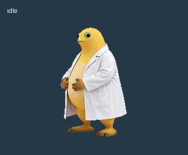

# 奶蛙桌宠 / Nailong Pets

包含两个版本：可以独立运行的 Windows 桌面宠物，以及 Codex / ChatGPT 桌面应用的原生宠物素材。

| 版本 | 目录 | 用途 |
| --- | --- | --- |
| 独立桌面版 | [`desktop/`](desktop/) | 完整大笑、笑声、定时镜像、马步节奏往返 |
| Codex 原生版 | [`codex/`](codex/) | 随应用任务状态切换动作，使用清理过边缘的透明动作表 |

## 独立桌面版

需要 Windows 10/11 和系统自带的 Windows PowerShell 5.1、WPF。无需安装 Python、Node.js 或下载其他运行库。

1. 下载本仓库 ZIP 并解压，或完整克隆仓库。保留 `desktop/assets/` 文件夹。
2. 双击 [`desktop/launch.vbs`](desktop/launch.vbs)。
3. 如果系统限制 VBS，打开 PowerShell，进入 `desktop` 文件夹后运行：

```powershell
powershell.exe -NoProfile -STA -ExecutionPolicy Bypass -File .\desktop-pet.ps1
```

操作方式：

- 左键拖动位置。
- 双击播放大笑。
- 右键切换动作、开启笑声、暂停或退出。
- 笑声默认关闭；开启后，下次进入大笑动作时播放。
- 不会设置开机自启，不会读取或控制 Codex 的任务。

自动动作顺序：白大褂待机 → 完整大笑 → 白大褂待机 → 马步往返 → 重复。

| 动作 | 默认行为 |
| --- | --- |
| 白大褂待机 | 持续 8 秒，每 4 秒镜像一次 |
| 大笑 | 原视频提取的 541 帧，30 帧/秒，约 18.03 秒，包含倒地结尾；不穿白大褂 |
| 马步 | 定姿 1.2 秒，向有空间的一侧节奏移动 4.8 秒，停顿 0.3 秒并镜像，再反向移动 4.8 秒；不穿白大褂 |

马步移动采用整张姿态图的位移与轻微起伏，没有重新绘制腿部走路。大笑结束直接切回待机，没有额外起身动画。

修改 [`desktop/config.json`](desktop/config.json) 后重启桌宠，可以调整大小、待机时间、镜像间隔、移动速度、节拍和默认声音状态。`auto_sequence` 记录默认顺序，当前播放器的切换顺序由脚本固定。

[查看独立桌面版演示](previews/desktop-demo.mp4)

## Codex / ChatGPT 原生版

[`codex/spritesheet.png`](codex/spritesheet.png) 是清晰版透明动作表：1536×1872 像素，8 列、9 行，每格 192×208 像素，v1 格式。已清理轮廓杂点、颜色残边，以及大笑画面的透明缺口和白底残留。

### 导入到应用宠物库

1. 打开应用设置中的 **Mini 与虚拟宠物 / Pets**。
2. 使用 **创建虚拟宠物 / Create pet** 或客户端提供的导入入口。
3. 上传 [`codex/spritesheet.png`](codex/spritesheet.png)，名称可填“奶龙 · 三动作”。
4. 选中该宠物，并打开浮动宠物。
5. 可在自定义外观中将大小设为 **128**，相对默认的 112 约放大 14%。

各客户端的入口名称可能不同。若提供原生图集导入，请使用 PNG 动作表，而不是 GIF 或独立播放器中的逐帧图片。

### 本地 pet.json 兼容安装

支持 `~/.codex/pets/<目录>/pet.json` 的客户端也可以运行：

```powershell
powershell.exe -NoProfile -ExecutionPolicy Bypass -File .\codex\install-local.ps1
```

脚本只安装本地素材，不修改账号、全局设置或当前宠物选择。安装后在应用中刷新宠物列表。某些客户端会将本地宠物迁移到内置宠物库；已经通过界面导入的用户无需重复运行此脚本。

### 原生动作映射

| 原生状态 | 当前素材 |
| --- | --- |
| `idle`、`waiting`、`review` | 白大褂待机 |
| `running-right`、`running-left`、`waving` | 马步；向左动作在单格内镜像 |
| `jumping`、`failed`、`running` | 大笑关键帧；`failed` 含倒地结尾 |

原生版的动作由应用状态和拖动操作触发。它使用固定帧数和固定播放时间，不能播放完整 18 秒大笑，也不能执行独立版的定时轮播、延迟翻转或自行往返。原生图集没有笑声音轨；对话和语音输入由应用自身提供，导入素材不会开启这些功能。

失败时也会出现大笑，这是当前动作映射的实际行为。



[查看清理前后对比](previews/edge-cleanup-comparison.jpg) · [查看原生版 MP4 预览](previews/codex-animations.mp4)

## 素材与验证

- 角色形象来自用户提供的两张参考图，并经过透明素材处理。
- 大笑动作和音轨来自用户提供的《奶龙大笑【原版】》视频文件，原视频条目：[BV1p2Tp6REay](https://www.bilibili.com/video/BV1p2Tp6REay)。
- 本仓库没有附加账号凭据、云端宠物 ID、本机路径配置或会话日志。
- 原生动作表已通过应用的格式校验；独立播放器包含离屏渲染检查入口：

```powershell
powershell.exe -NoProfile -STA -ExecutionPolicy Bypass -File .\desktop\desktop-pet.ps1 -Verify
```

检查结果写入 `desktop/qa-runtime/`，该目录已由 Git 忽略。
